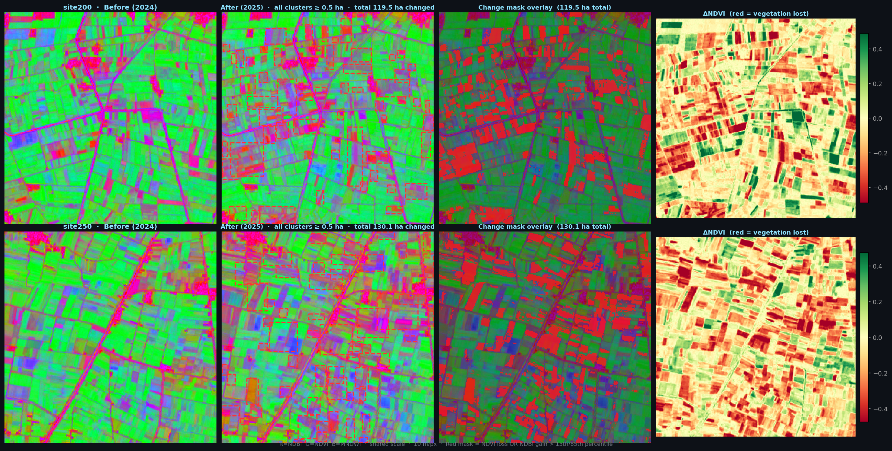

# KEMET1: Detecting Encroachment on Agricultural Land

Change detection on Sentinel-2 imagery to flag where farmland in Egypt's Nile
Delta has been built over. Given a before/after pair of tiles for a site, the
system scores how likely the site is to contain encroachment, outlines the
changed clusters, and writes a per-site report.



*Two of the 300 sites. Left to right: before (2024), after (2025), detected
change mask, and the NDVI difference (red = vegetation lost). False colour:
R = NDBI, G = NDVI, B = MNDWI, at 10 m per pixel.*

This was a graduation project built by a Data & AI team. The code and
experiments in this repository were committed by
[Shahd Elkilany](https://github.com/Shahd-M-Elkilany).

## Results

[](https://github.com/Shahd-M-Elkilany/detecting-encroachment-on-agricultural-land/actions/workflows/ci.yml)

The production model is a Random Forest over 44 spectral-change features
(7 statistics for each of 6 band differences, plus mean ΔNDVI and mean ΔNDBI),
trained on 300 co-registered Sentinel-2 tile pairs (2024 vs 2025).

| Evaluation | AUC | Notes |
| --- | --- | --- |
| Validation (45 sites) | 0.861 | 95% bootstrap CI 0.74 to 0.96 |
| Held-out test (45 sites, 11 positive) | 0.872 | Stratified 70/15/15 split, seed 42 |
| Same protocol over 30 random splits, test | 0.799 ± 0.068 | Range 0.68 to 0.90 |
| Geographic holdout, train south / test north | 0.717 | Split at the median latitude |
| Geographic holdout, train north / test south | 0.688 | 150 sites per half |

The 30-split row is the fairest single summary: the seed-42 split that the
shipped model was trained on lands near the top of that range.

On the seed-42 test split, the shipped (Platt-calibrated) model trades off as follows:

| Score and threshold | Precision | Recall | Correct / false alarms / missed |
| --- | --- | --- | --- |
| RF probability ≥ 0.23 | 0.64 | 0.82 | 9 / 5 / 2 |
| RF probability ≥ 0.40 | 0.86 | 0.55 | 6 / 1 / 5 |
| Web-app alarm "Medium" (fusion ≥ 0.23) | 0.78 | 0.64 | 7 / 2 / 4 |
| Web-app alarm "High" (fusion ≥ 0.40) | 1.00 | 0.27 | 3 / 0 / 8 |

The fusion score is what `app.py` reports (`0.65 × RF + 0.35 × mean NDVI loss`).
`run_inference.py` uses 0.30 instead of 0.23 for its medium tier.

### What these numbers do and do not show

- **The labels are automatic, not surveyed.** A site is labelled positive when
  `pct_converted > 0.02576` or `max_cluster_ha > 3.13`, which gives 78 positive
  and 222 negative sites; a test checks that this rule explains all 300 labels.
  The model is therefore learning to reproduce a spectral rule from other
  spectral features, and every figure above measures agreement with that rule.
  The labels have not been checked against ground surveys or
  very-high-resolution imagery.
- **A label leak was found and removed.** Early versions included `pct_conv`
  and `pct_new` as features, which are computed from the same threshold that
  produces the labels. With them the test AUC was 1.0; without them it is
  0.88 in the ablation run (`results/ablation_results.json`). Every number
  above is from the 44-feature model that excludes them.
- **The result depends on the split.** Repeating the 70/15/15 protocol with
  the production hyper-parameters over 30 seeds gives a test AUC between 0.68
  and 0.90 (`results/repeated_splits.json`, from `repeated_splits.py`).
- **Spatial generalisation is weaker than the random split suggests.** Training
  on one half of the Delta and testing on the other drops AUC to about 0.70.
- **The test set is small.** 45 sites with 11 positives, so one site moves
  recall by 9 points.

## How it works

1. Sentinel-2 L2A tiles for each site are exported from Google Earth Engine
   (`gee_sample_download.js`), one for 2024 and one for 2025.
2. For each pair, per-band differences and the NDVI and NDBI changes are
   summarised into 44 statistics.
3. A Random Forest with Platt-calibrated probabilities scores the site.
4. The RF score is fused with a pixel-level spectral check
   (`0.65 × RF + 0.35 × spectral`), where a pixel counts as converted when
   NDVI falls below 0.25 and NDBI rises by more than 0.08.
5. Converted pixels are grouped into clusters, measured in hectares, and
   written to an HTML report with a map.

## Quick start

```bash
pip install -r requirements.txt

# Evaluate the shipped model on the held-out test split
python evaluate_ba.py

# Retrain the 44-feature model and rerun the leak ablation
python ablation_no_circular.py

# Geographic holdout (north/south split)
python geographic_holdout.py

# Spread of the metrics over 30 random splits
python repeated_splits.py

# Score one site and write an HTML report to outputs/
python run_inference.py --site site0

# Serve the web interface locally
python app.py
```

The Sentinel-2 tiles are not stored in this repository. Scripts that read
them expect `data/KEMET1_BeforeAfter/KEMET1_BeforeAfter_Tiles/` to contain
files named `site{N}_before_2024.tif` and `site{N}_after_2025.tif`.

To run in a container:

```bash
docker build -t kemet1 .
docker run -p 8000:8000 kemet1
```

## Tests

```bash
pip install -r requirements.txt pytest httpx
pytest
```

The 30 tests run on synthetic tiles, so they need no dataset. They check that
the five copies of the feature code (`evaluate_ba.py`, `geographic_holdout.py`,
`ablation_no_circular.py`, `run_inference.py`, `app.py`) produce identical
features, that clustering and area figures are right, that the shipped labels,
results files and model are consistent with each other and with this README,
and that the web API scores a tile pair end to end. They run on every push
through GitHub Actions, together with a syntax check of every script.

## Repository layout

```
app.py                    FastAPI server for the web interface (static/)
run_inference.py          Score one site and write an HTML report
evaluate_ba.py            Test-split evaluation and results dashboard
ablation_no_circular.py   Retrain without the leaking features
geographic_holdout.py     North/south spatial holdout
repeated_splits.py        Metric spread over 30 random splits
tests/                    Unit and API tests on synthetic tiles
batch_report.py           Regenerate reports for all positive sites
upload_case.py            Send one site to the backend API
batch_upload.py           Send all positive sites, with geocoding and retries
pipeline.py, run.py       The experimental 8-step pipeline (see below)
src/                      Pipeline step modules
config/settings.py        Pipeline configuration
models/                   Trained Random Forest bundles
data/                     Labels and evaluation outputs (JSON)
results/                  Dashboards, ablation output, sample imagery
reports/                  Generated HTML reports for the 78 positive sites
docs/                     Project report, figures and dataset notes
```

## Experimental 8-step pipeline

`pipeline.py` and `src/` hold a longer pipeline that was explored alongside
the classifier: Sentinel-2 acquisition, cloud detection (U-Net with a ResNet34
encoder), cloud removal by inpainting, spectral indices, NDBI-threshold change
detection, agriculture segmentation (SegFormer-B4), building detection (SAM),
and a final intersection that maps buildings on farmland. It uses pretrained
weights without fine-tuning on Nile Delta data and needs the optional
dependencies listed at the bottom of `requirements.txt`. The results reported
above come from the Random Forest classifier, not from this pipeline.

`train_classifier.py`, `evaluate.py` and `predict.py` belong to an earlier
multi-temporal classifier (75 tiles over four dates, labelled visually by one
annotator) that this model replaced. Its trained model file and tiles are not
in this repository, so its results cannot be reproduced from here and are not
quoted above.

## Data sources

- Sentinel-2 L2A surface reflectance (Copernicus), accessed through Google
  Earth Engine.
- Dataset notes are in [`docs/datasets_reference.md`](docs/datasets_reference.md).
