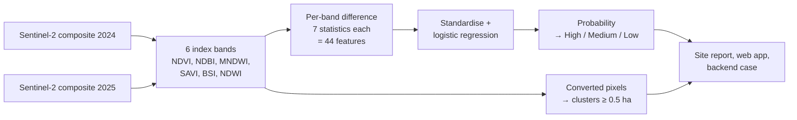

# KEMET1: detecting building encroachment on Nile Delta farmland

[](https://github.com/Shahd-M-Elkilany/detecting-encroachment-on-agricultural-land/actions/workflows/ci.yml)


Egypt loses farmland in the Nile Delta to unlicensed building every year. KEMET1
compares two Sentinel-2 images of the same 2.6 km site, one from 2024 and one
from 2025, and estimates how likely it is that farmland was built over. It ranks
sites for inspection, outlines where the change happened and produces a report,
a web app and cases for the team's monitoring backend.


<sub>Three of the 45 held-out test sites. Top: a correct High alarm, with several hectares of fields turned
built-up. Middle: a false alarm, where harvest timing removed vegetation across the whole tile. Bottom: a miss
on reclaimed desert land, where the change happens on ground that was never green.</sub>

## Results

The 300 sites carry automatic labels (see [what the labels are](#what-the-labels-are)). Every figure below
measures how well the model reproduces those labels from spectral change alone.

| Evaluation | v2: logistic regression | v1: Random Forest | Notes |
| --- | ---: | ---: | --- |
| Random 5-fold CV ×10, all 300 sites | **0.90** ± 0.04 | 0.81 ± 0.06 | ROC AUC; the headline figure |
| Spatial 5-fold CV, whole regions held out | **0.86** | 0.69 | Mean of 5 regions (v2 range 0.70 to 0.94) |
| Held-out test sites (45, 11 positive) | **0.97** | 0.88 | 95 % CI for v2: 0.91 to 1.00 |


Both models use the same 44 features and the same sites. Moving from a Random Forest to a regularised
logistic regression is the main change, and it holds up best where it matters: on regions the model has
never seen, AUC rises from 0.69 to 0.86.

**Alarm tiers.** A site's risk comes from the model's probability. Both thresholds were fixed on
cross-validated predictions for the 255 development sites, then applied once to the 45 test sites:

| Tier | Threshold | Precision | Recall | Correct / false alarms / missed (test) |
| --- | ---: | ---: | ---: | --- |
| High ("likely encroachment") | ≥ 0.51 | 0.90 | 0.82 | 9 / 1 / 2 |
| Medium or above ("check this site") | ≥ 0.16 | 0.59 | 0.91 | 10 / 7 / 1 |

On the development sites, where 255 sites give a steadier estimate than 45, the same thresholds give
precision 0.77 at recall 0.55 for High and precision 0.52 at recall 0.91 for Medium. Expect numbers between
the two on new sites.


Full results, including per-site test probabilities and calibration, are in
[`results/evaluation.json`](results/evaluation.json).

## What the labels are

The labels were not drawn by hand. A site is positive when at least 2.576 % of its pixels went from vegetated
to built-up (NDVI falls below 0.25 and NDBI rises by more than 0.08), or when one connected patch of such
pixels exceeds 3.13 ha. That gives 78 positive and 222 negative sites. `kemet1 extract` recomputes both
quantities from the tiles and reproduces all 300 labels exactly.

What follows from that:

- **The model learns a spectral rule, not ground truth.** A High result marks a site worth inspecting on
  very-high-resolution imagery or on the ground; it is not proof of illegal building. The rule itself cannot
  tell a new house from a harvested field that happens to look built-up, as the middle example shows.
- **The rule's own inputs are never features.** v1 once included them and scored a perfect 1.0, a label
  leak that was found and removed. The 44 features are statistics of band differences, which the rule does
  not use directly.
- **Real accuracy needs real labels.** Labelling even 50 to 100 sites by hand from historical
  very-high-resolution imagery would turn these figures into accuracy estimates; `kemet1 evaluate` works
  unchanged on a feature table with those labels.

## How it works



1. **Tiles.** Each site is a 262 × 262 pixel tile (10 m) per year carrying six spectral indices computed from
   Sentinel-2 bands. [`scripts/gee_sample_export.js`](scripts/gee_sample_export.js) shows the index
   computation in Google Earth Engine.
2. **Features.** For each index, the after-minus-before difference is summarised by its mean, standard
   deviation and 10th to 90th percentiles; mean NDVI and NDBI change complete the 44.
3. **Model.** A standardised L2 logistic regression (C = 1), chosen over a Random Forest and gradient
   boosting by repeated cross-validation on the development sites
   ([`results/evaluation.json`](results/evaluation.json), `model_selection_cv_on_development`).
4. **Where it changed.** Pixels that switched from vegetated to built-up are grouped into connected clusters
   of at least 0.5 ha, scored by built-up gain and NDVI loss, and drawn on the report in red, orange or yellow.
5. **Outputs.** An HTML report per site with a map
   ([example](docs/examples/site264_report.html)), a summary map of all sites, a FastAPI web app, and cases
   submitted to the KEMET backend.


## Quick start

```bash
git clone https://github.com/Shahd-M-Elkilany/detecting-encroachment-on-agricultural-land.git
cd detecting-encroachment-on-agricultural-land
pip install -e ".[dev]"

make reproduce          # train, evaluate and redraw every figure from data/features.csv (~2 min)
pytest                  # 40 tests, no satellite tiles needed
```

With tiles in `data/tiles/` (named `site{N}_before_2024.tif` and `site{N}_after_2025.tif`, see
[`docs/DATA.md`](docs/DATA.md)):

```bash
kemet1 extract                          # recompute data/features.csv from the tiles
kemet1 score site264                    # one site -> outputs/reports/site264_report.html
kemet1 score --before a.tif --after b.tif
kemet1 report                           # every positive site + an index.html summary map
kemet1 upload site264 --dry-run         # build the backend case without sending it
kemet1 serve                            # web app on http://localhost:8000
```

Or with Docker: `docker build -t kemet1 . && docker run -p 8000:8000 kemet1`.

## Repository layout

```
encroachment/          the package
  features.py          tile reading, the 44 features, the labelling rule
  clusters.py          converted-pixel clusters and their scores
  model.py             candidate models, training, saving and loading
  evaluation.py        dev/test split, cross-validation, spatial folds, threshold choice
  alarm.py             the two risk thresholds
  analysis.py          scores one site
  report.py, imagery.py, templates/   HTML site reports and the summary map
  backend.py           cases for the KEMET team backend
  web/                 FastAPI app and its page
  figures.py           every figure in this README
  cli.py               the kemet1 command
data/                  labels.json, features.csv (300 sites x 44 features + coordinates)
models/                the trained model and its metadata (training sites, held-out sites)
results/               evaluation.json; v1/ keeps the original project's results
docs/                  data and model notes, figures, an example report, the team's project documents
tests/                 unit, integration and consistency tests
scripts/               an example Earth Engine export of the six indices
archive/               earlier stages: v1 scripts, a multi-date classifier, an 8-step deep-learning pipeline
```

## Testing

`pytest` runs 40 tests in a few seconds. Besides unit tests on synthetic tiles, they check that the shipped
model reproduces the reported test AUC from the committed feature table, that retraining gives the same
coefficients, that the test split is the same 45 sites v1 was evaluated on, that the labels are exactly the
documented rule, that the alarm thresholds are the ones chosen on development data, that every number in
this README matches `results/evaluation.json`, and that the web API scores a GeoTIFF pair end to end. GitHub
Actions runs them with lint on every push.

The feature code was also checked against the real data: run on all 300 tile pairs, it reproduces the
committed feature table to within 5 × 10⁻⁶ and the labelling inputs exactly.

## Limitations

- **Automatic labels.** See above. This is the main limitation and the main next step.
- **Seasonal confusion.** Harvest or fallow timing can mimic conversion; the one High false alarm on the test
  sites is a tile-wide harvest.
- **Desert reclamation.** Building on land that was never green barely moves NDVI, so it is easy to miss.
- **One region's spatial fold is weak.** Holding out the north-east (fold 5, 6 positives) gives AUC 0.70.
- **Two dates only, 10 m pixels.** Single houses are below what Sentinel-2 resolves; the cluster minimum is
  0.5 ha.

## Data and credits

Sentinel-2 L2A surface reflectance (Copernicus) via Google Earth Engine. The 300 tile pairs (1.1 GB) are not
stored in the repository; [`docs/DATA.md`](docs/DATA.md) describes them and how to obtain them.

KEMET1 began as a graduation project of a Data & AI team; the project report, presentation and dataset
documents are in [`docs/project/`](docs/project). This repository, the v2 model and the package are
maintained by [Shahd Elkilany](https://github.com/Shahd-M-Elkilany).
