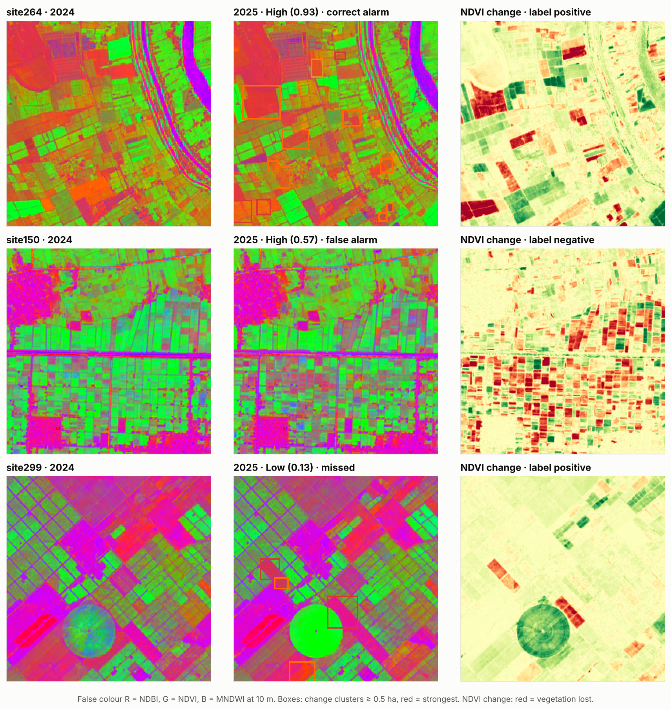
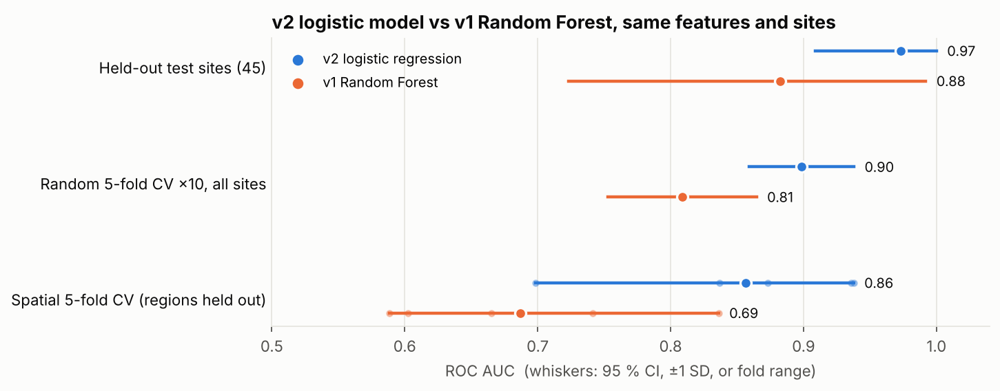
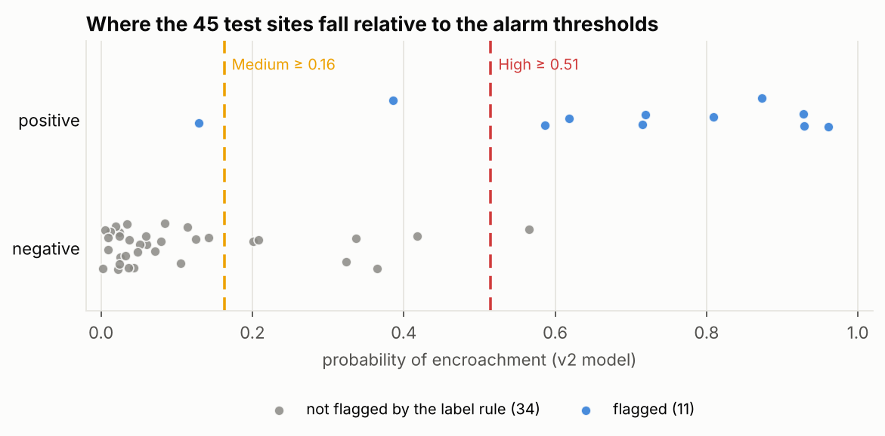
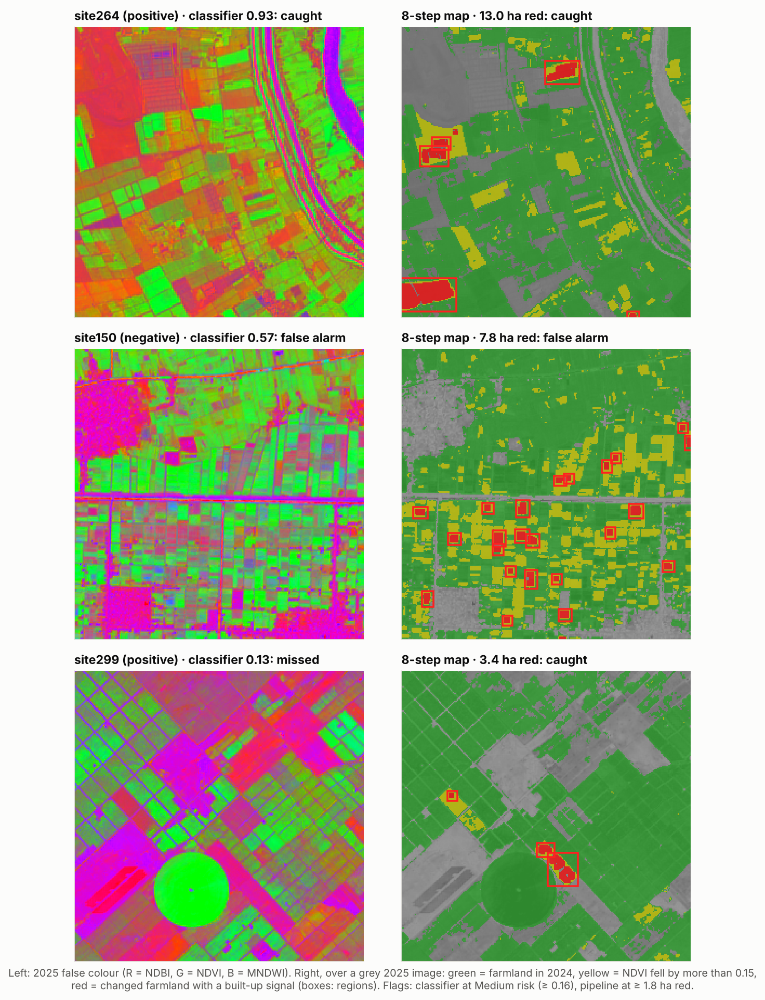
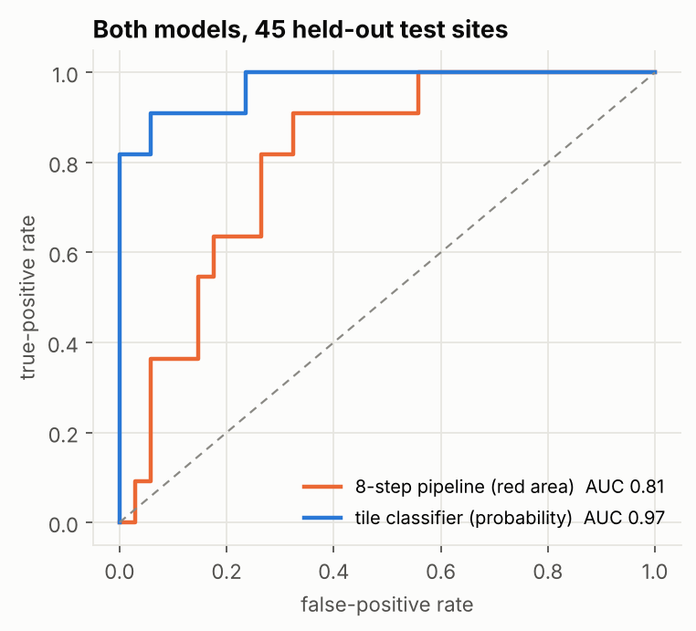
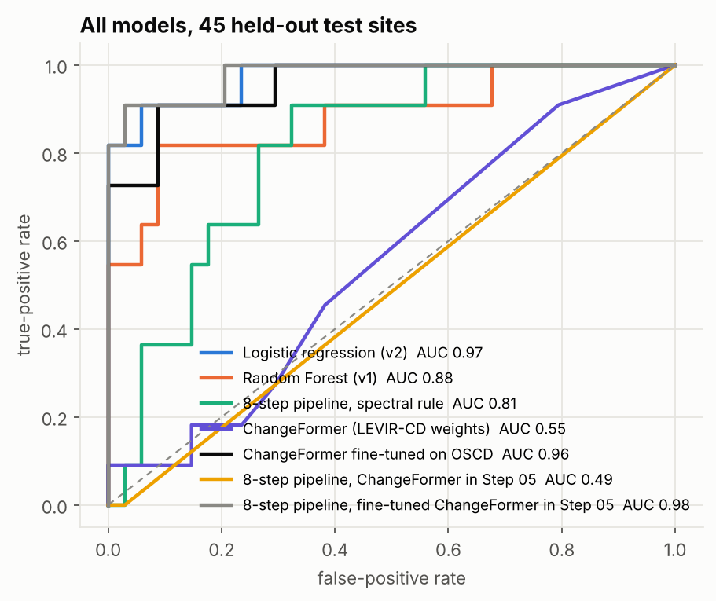
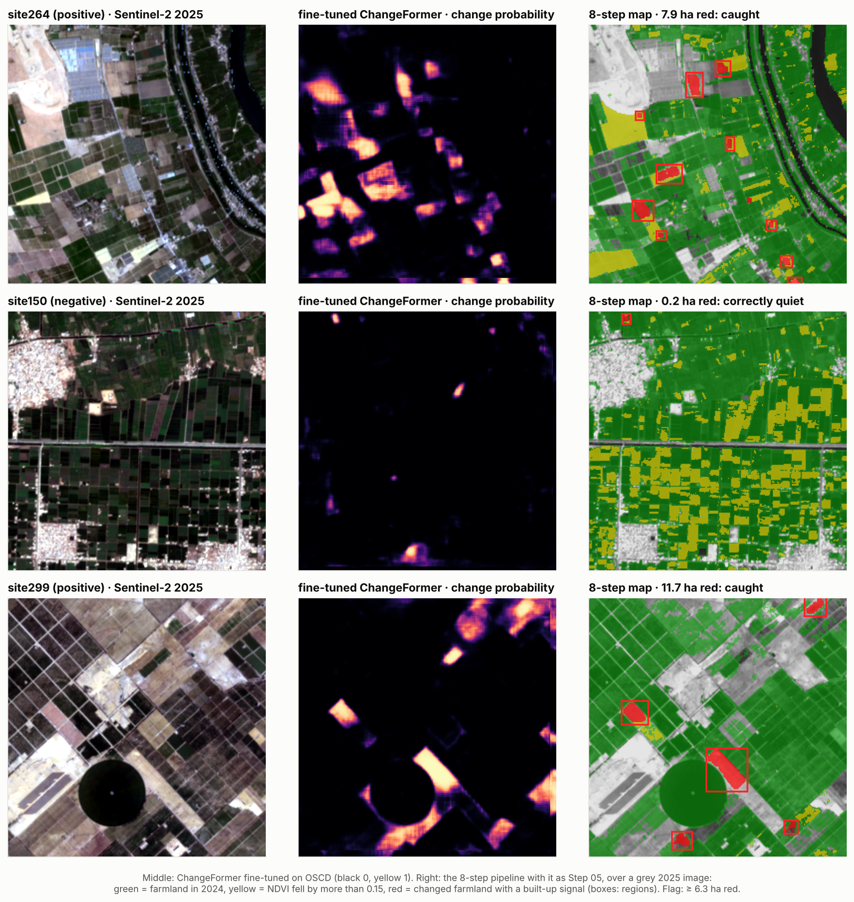
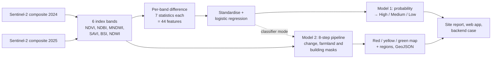
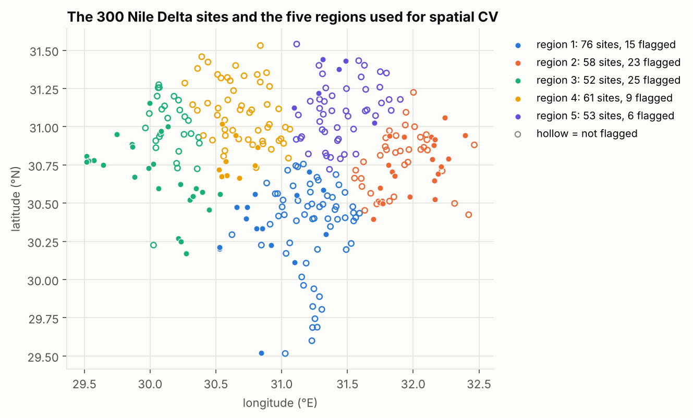

# KEMET1: detecting building encroachment on Nile Delta farmland

[](https://github.com/Shahd-M-Elkilany/detecting-encroachment-on-agricultural-land/actions/workflows/ci.yml)


Building on farmland is a long-running problem in Egypt's Nile Delta. KEMET1 compares two Sentinel-2 images of
the same 2.6 km site, one from 2024 and one from 2025, with two models:

- **a tile classifier** (Random Forest in v1, regularised logistic regression in v2) that gives each site a
  probability of encroachment and ranks sites for inspection, and
- **an 8-step pipeline** (cloud detection, change detection, farmland and building masks) that maps where the
  change happened, pixel by pixel, as a red / yellow / green map. With a ChangeFormer transformer fine-tuned on
  Sentinel-2 change data as its change detector, it is the most accurate system in the project.

Both are evaluated against the same labels and test sites, and both feed site reports, a web app and cases for
the team's monitoring backend.



<sub>Three of the 45 held-out test sites, as the classifier sees them. Top: a correct High alarm, with several hectares of fields turned
built-up. Middle: a false alarm, where vegetation fell across much of the tile, most likely harvest or fallow timing.
Bottom: a miss in a reclaimed-desert landscape, where fields elsewhere in the tile growing greener (the circle,
mean NDVI 0.48 → 0.70) outweigh about 6 ha of conversion in the tile-wide statistics.</sub>

## The two models at a glance

| | Model 1: tile classifier | Model 2: 8-step pipeline |
| --- | --- | --- |
| Question it answers | How likely is it that this site was encroached? | Where in the site did farmland change? |
| Output | One probability per site → High / Medium / Low risk | Red / yellow / green map, outlined regions, GeoJSON |
| Method | 44 band-difference statistics → logistic regression | Fine-tuned ChangeFormer change map → farmland and building masks → alert map |
| Test-site AUC (45 sites) | 0.97 | **0.98** (0.81 with the spectral-rule Step 05) |
| Test precision / recall | 0.67 / 0.91 | **0.91 / 0.91** |
| Code | [`encroachment/`](encroachment) | [`pipeline/`](pipeline) |

The 300 sites carry automatic labels (see [what the labels are](#what-the-labels-are)). Every number in this
README measures how well a model reproduces those labels from spectral change alone.

## Model 1: the tile classifier

| Evaluation | v2: logistic regression | v1: Random Forest | Notes |
| --- | ---: | ---: | --- |
| Random 5-fold CV ×10, all 300 sites | **0.90** ± 0.04 | 0.81 ± 0.06 | ROC AUC; the headline figure |
| Spatial 5-fold CV, whole regions held out | **0.86** | 0.69 | Mean of 5 regions (v2 range 0.70 to 0.94) |
| Held-out test sites (45, 11 positive) | **0.97** | 0.88 | 95 % CI for v2: 0.91 to 1.00 |



v1 and v2 use the same 44 features and the same sites. Moving from a Random Forest to a regularised logistic
regression is the main change, and it holds up best where it matters: on regions the model has never seen,
AUC rises from 0.69 to 0.86.

**Alarm tiers.** A site's risk comes from the model's probability. Both thresholds were fixed on
cross-validated predictions for the 255 development sites, then applied once to the 45 test sites:

| Tier | Threshold | Precision | Recall | Correct / false alarms / missed (test) |
| --- | ---: | ---: | ---: | --- |
| High ("likely encroachment") | ≥ 0.51 | 0.90 | 0.82 | 9 / 1 / 2 |
| Medium or above ("check this site") | ≥ 0.16 | 0.59 | 0.91 | 10 / 7 / 1 |

On the development sites, where 255 sites give a steadier estimate than 45, the same thresholds give
precision 0.77 at recall 0.55 for High and precision 0.52 at recall 0.91 for Medium. Expect numbers between
the two on new sites.



Full results, including per-site test probabilities and calibration, are in
[`results/evaluation.json`](results/evaluation.json).

## Model 2: the 8-step pipeline

The team designed the pipeline around pretrained deep models: a U-Net for clouds, ChangeFormer for change,
SegFormer for farmland and YOLOv8 with SAM for buildings. The project's tiles carry six spectral indices rather
than raw bands, which those models were not trained on, so on this data each step runs the spectral rule it falls
back to (for example NDVI > 0.2 for farmland, an NDBI rise for buildings). The results below are for that
configuration; details and the per-step table are in [`pipeline/README.md`](pipeline/README.md). The deep change
detector itself was tested separately on matching colour images, [below](#deep-learning-changeformer).



<sub>Right: green = farmland in 2024, yellow = vegetation loss, red = changed farmland with a built-up signal.
The pipeline catches site299, which the classifier misses, but also turns the harvested fields of site150 red.</sub>

Using the red area per site as its score, on the same labels and test sites as the classifier
([`results/pipeline_evaluation.json`](results/pipeline_evaluation.json)):

| Pipeline evaluation | Value |
| --- | ---: |
| ROC AUC, all 300 sites | 0.75 |
| ROC AUC, 45 test sites | 0.81 (95 % CI 0.67 to 0.93) |
| Test precision / recall, ≥ 1.8 ha red (threshold chosen on development sites) | 0.38 / 0.91 |

The classifier is the better tool for deciding which sites to inspect; the pipeline shows where to look inside
a site. In classifier mode (`run.py --kemet1`) the two work together: the classifier decides whether the site is
at risk and the pipeline maps the converted fields.



## Deep learning: ChangeFormer

The pipeline was designed around ChangeFormer, a transformer change detector, in Step 05. To test it, the
Sentinel-2 colour images behind all 300 tiles were downloaded on the same pixel grid and ChangeFormerV6 was run on
every pair, first with its published LEVIR-CD weights, then after fine-tuning on Sentinel-2 change data. Every
method is scored against the same labels and the same 45 test sites
([`results/model_comparison.json`](results/model_comparison.json)):

| Method | Development AUC | Test AUC (95 % CI) | Test precision / recall |
| --- | ---: | ---: | ---: |
| Logistic regression (v2) | 0.88 | 0.97 (0.91 to 1.00) | 0.67 / 0.91 |
| 8-step pipeline, fine-tuned ChangeFormer in Step 05 | 0.86 | **0.98** (0.92 to 1.00) | **0.91 / 0.91** |
| ChangeFormer fine-tuned on OSCD | 0.83 | 0.96 (0.88 to 1.00) | 0.71 / 0.91 |
| Random Forest (v1) | 0.78 | 0.88 (0.72 to 0.99) | 0.50 / 0.82 |
| 8-step pipeline, spectral rule in Step 05 | 0.74 | 0.81 (0.67 to 0.93) | 0.38 / 0.91 |
| ChangeFormer alone, LEVIR-CD weights (best setting on development) | 0.54 | 0.55 (0.38 to 0.73) | 0.24 / 1.00 |
| 8-step pipeline, ChangeFormer in Step 05 (LEVIR-CD weights) | 0.50 | 0.49 (0.45 to 0.50) | 0.24 / 1.00 |

<sub>Development AUC for the two classifiers is out-of-fold. Precision and recall use the threshold with the best F1 on
the development sites; a precision of 0.24 with recall 1.00 means flagging every test site. LEVIR-CD ChangeFormer at
4× upsampling, run on the test sites only, scores 0.51.</sub>



**Off the shelf, it fails.** The published checkpoint works (it reproduces its authors' predictions on LEVIR-CD
exactly), but LEVIR-CD is 0.5 m aerial imagery, where a house covers hundreds of pixels; at Sentinel-2's 10 m it is
smaller than one pixel, and the model sees almost no change anywhere:


The team's sliding-window idea, cutting 130 m windows and resizing them to LEVIR-CD's 0.5 m pixels, was tested too:
on 33 windows centred on fields the labels mark as converted, ChangeFormer marked change in 1. Resizing enlarges
10 m pixels without adding detail, so the model sees blurred colour patches instead of buildings:


**Fine-tuned on Sentinel-2, it works.** Starting from the LEVIR-CD weights, ChangeFormer was fine-tuned for 2,000
steps on OSCD, 14 Sentinel-2 image pairs at 10 m with hand-drawn urban-change masks, in a colour and a 5-band
version ([notebook](pipeline/changeformer/finetune_oscd.ipynb), Colab T4). On OSCD's own 10 test pairs the
change-class F1 rose from 0.01 to 0.48. On the KEMET1 sites, the colour version (chosen on the development sites)
reaches a test AUC of 0.96, close to the logistic regression and above the Random Forest, with the best test
precision of any method. It never sees NDVI or NDBI, the indices the labels are computed from, so its agreement
with the labels is independent evidence that both capture real conversion to built-up land.

**As Step 05 of the 8-step pipeline, it completes the original design.** ChangeFormer finds where the scene
changed; the pipeline's farmland and built-up masks keep only changes from farmland to built-up land. The
combination is the most accurate system here: on the 45 test sites it catches 10 of the 11 encroached sites with
one false alarm. It also gets right both example sites the classifier gets wrong, the harvest false alarm and the missed
conversion next to a greening field:



Two cautions. With 11 positive test sites, the differences between the top three methods (0.96 to 0.98) are well
inside their confidence intervals. And the pipeline's farmland and built-up masks use NDVI and NDBI thresholds close
to those of the labelling rule, so part of its agreement with the labels is shared design; the ChangeFormer row
above, which sees colour only, is the cleaner test of the deep model.
Method and reproduction: [`pipeline/changeformer/README.md`](pipeline/changeformer/README.md).

## What the labels are

The labels were not drawn by hand. A site is positive when at least 2.576 % of its pixels went from vegetated
to built-up (NDVI falls below 0.25 and NDBI rises by more than 0.08), or when one connected patch of such
pixels exceeds 3.13 ha. That gives 78 positive and 222 negative sites. `kemet1 extract` recomputes both
quantities from the tiles and reproduces all 300 labels exactly.

What follows from that:

- **The model learns a spectral rule, not ground truth.** A High result marks a site worth inspecting on
  very-high-resolution imagery or on the ground; it is not proof of illegal building. The rule itself cannot
  tell a new house from a harvested field that happens to look built-up, as the middle example shows.
- **The rule's own inputs are never features.** v1 once included them and scored a perfect 1.0, a label
  leak that was found and removed. The 44 features are statistics of band differences, which the rule does
  not use directly.
- **Real accuracy needs real labels.** Labelling even 50 to 100 sites by hand from historical
  very-high-resolution imagery would turn these figures into accuracy estimates; `kemet1 evaluate` works
  unchanged on a feature table with those labels.

## How it works



1. **Tiles.** Each site is a 262 × 262 pixel tile (10 m) per year carrying six spectral indices computed from
   Sentinel-2 bands. [`scripts/gee_sample_export.js`](scripts/gee_sample_export.js) shows the index
   computation in Google Earth Engine.
2. **Features.** For each index, the after-minus-before difference is summarised by its mean, standard
   deviation and 10th to 90th percentiles; mean NDVI and NDBI change complete the 44.
3. **Model.** A standardised L2 logistic regression (C = 1), chosen over a Random Forest and gradient
   boosting by repeated cross-validation on the development sites
   ([`results/evaluation.json`](results/evaluation.json), `model_selection_cv_on_development`).
4. **Where it changed.** Pixels that switched from vegetated to built-up are grouped into connected clusters
   of at least 0.5 ha, scored by built-up gain and NDVI loss, and drawn on the report in red, orange or yellow.
5. **Pipeline.** The 8-step pipeline marks farmland (NDVI before), changed pixels (band difference) and new
   built-up land (NDBI rise) and combines them into the alert map; see [`pipeline/README.md`](pipeline/README.md).
6. **Outputs.** An HTML report per site with a map
   ([example](docs/examples/site264_report.html)), a summary map of all sites, the pipeline's map and GeoJSON,
   a FastAPI web app, and cases submitted to the KEMET backend.



## Quick start

```bash
git clone https://github.com/Shahd-M-Elkilany/detecting-encroachment-on-agricultural-land.git
cd detecting-encroachment-on-agricultural-land
pip install -e ".[dev]"

make reproduce          # train, evaluate both models and redraw every figure from committed data (~2 min)
pytest                  # 48 tests, no satellite tiles needed
make pipeline-demo      # the 8-step pipeline on a synthetic image pair
```

With tiles in `data/tiles/` (named `site{N}_before_2024.tif` and `site{N}_after_2025.tif`, see
[`docs/DATA.md`](docs/DATA.md)):

```bash
kemet1 extract                          # recompute data/features.csv from the tiles
kemet1 score site264                    # one site -> outputs/reports/site264_report.html
kemet1 score --before a.tif --after b.tif
kemet1 report                           # every positive site + an index.html summary map
kemet1 upload site264 --dry-run         # build the backend case without sending it
kemet1 serve                            # web app on http://localhost:8000

cd pipeline && python run_full_pipeline.py --site site264   # the 8-step map for one site
```

Or with Docker: `docker build -t kemet1 . && docker run -p 8000:8000 kemet1`.

## Repository layout

```
encroachment/          the package
  features.py          tile reading, the 44 features, the labelling rule
  clusters.py          converted-pixel clusters and their scores
  model.py             candidate models, training, saving and loading
  evaluation.py        dev/test split, cross-validation, spatial folds, threshold choice
  alarm.py             the two risk thresholds
  analysis.py          scores one site
  report.py, imagery.py, templates/   HTML site reports and the summary map
  backend.py           cases for the KEMET team backend
  web/                 FastAPI app and its page
  figures.py           every figure in this README
  cli.py               the kemet1 command
data/                  labels.json, features.csv (300 sites x 44 features + coordinates)
models/                the trained model and its metadata (training sites, held-out sites)
pipeline/              the 8-step pipeline: run.py, one module per step, evaluate_pipeline.py, compare_models.py
  changeformer/        Sentinel-2 colour download and the ChangeFormer experiment
results/               evaluation.json, pipeline and ChangeFormer scores, model_comparison.json; v1/ keeps the original results
docs/                  data and model notes, figures, an example report, the team's project documents
tests/                 unit, integration and consistency tests
scripts/               an example Earth Engine export of the six indices
archive/               earlier stages: v1 scripts, a multi-date classifier, dataset export tools
```

## Testing

`pytest` runs 48 tests in under a minute. Besides unit tests on synthetic tiles, they check that the shipped
model reproduces the reported test AUC from the committed feature table, that retraining gives the same
coefficients, that the test split is the same 45 sites v1 was evaluated on, that the labels are exactly the
documented rule, that the alarm thresholds are the ones chosen on development data, that every number in
this README matches `results/evaluation.json`, and that the web API scores a GeoTIFF pair end to end. For the
pipeline, they check that it outlines a planted conversion and stays quiet on an unchanged pair, that a full
run writes every Step 08 output, that its classifier mode agrees with the package, and that its evaluation
reproduces from `results/pipeline_scores.csv`; the five-method comparison, ChangeFormer included, is recomputed
from the committed scores and checked against the table above. GitHub Actions runs them with lint on every push.

The feature code was also checked against the real data: run on all 300 tile pairs, it reproduces the
committed feature table to within 5 × 10⁻⁶ and the labelling inputs exactly.

## Limitations

- **Automatic labels.** See above. This is the main limitation and the main next step.
- **Seasonal confusion.** Harvest or fallow timing can mimic conversion; the one High false alarm on the test
  sites is most likely a tile-wide harvest.
- **Tile-wide features.** The model sees statistics of the whole 684 ha tile, so vegetation gains elsewhere
  (a field growing greener, for example) can mask a few hectares of conversion, as in the missed example.
- **One region's spatial fold is weak.** Holding out the north-east (fold 5, 6 positives) gives AUC 0.70.
- **Pretrained deep models do not transfer to 10 m imagery.** ChangeFormer (LEVIR-CD) scores at chance on these
  sites; SegFormer and YOLOv8 + SAM, which also expect high-resolution RGB, have not been evaluated.
- **Two dates only, 10 m pixels.** Single houses are below what Sentinel-2 resolves; the cluster minimum is
  0.5 ha.

## Data and credits

Sentinel-2 L2A surface reflectance (Copernicus) via Google Earth Engine. The 300 tile pairs (1.1 GB) are not
stored in the repository; [`docs/DATA.md`](docs/DATA.md) describes them and how to obtain them.

KEMET1 began as a graduation project of a Data & AI team; the project report, presentation and dataset
documents are in [`docs/project/`](docs/project). This repository, the v2 model and the package are
maintained by [Shahd Elkilany](https://github.com/Shahd-M-Elkilany).
