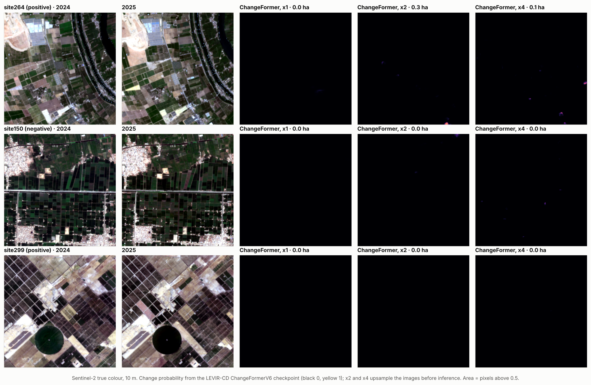
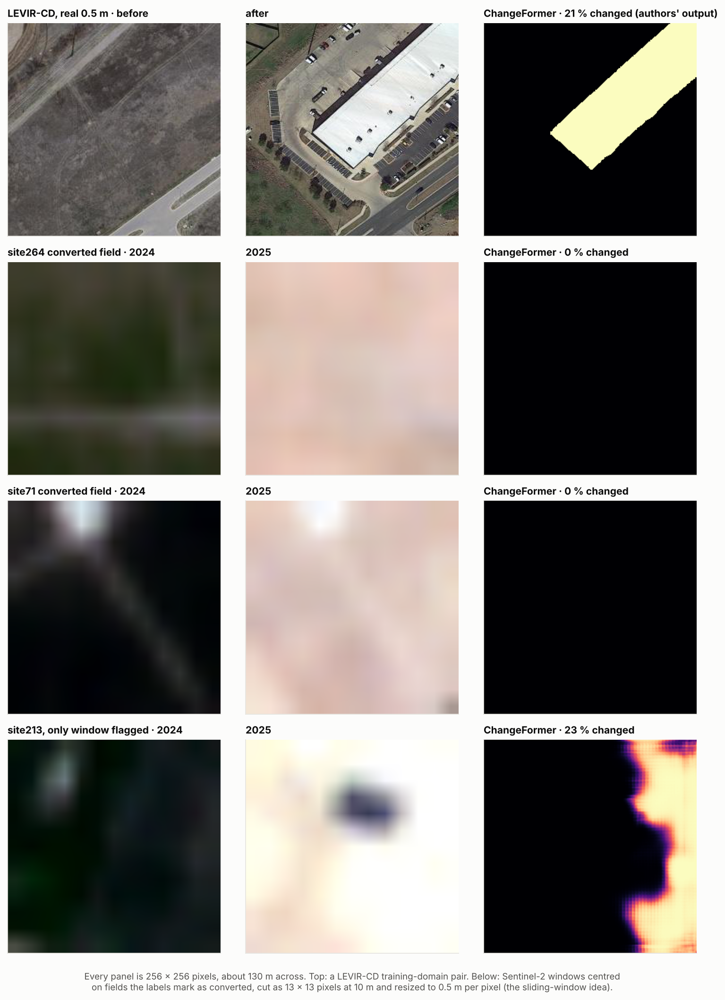

# ChangeFormer on the KEMET1 sites

The 8-step pipeline was designed with ChangeFormer, a Siamese transformer for building change detection, as its
Step 05. This folder tests that design on the project's 300 sites with the published ChangeFormerV6 checkpoint
trained on LEVIR-CD (`best_ckpt.pt`, change-class F1 ≈ 0.90 on the LEVIR-CD test set).



## What was run

1. **Colour images.** ChangeFormer takes RGB pairs, but the KEMET1 tiles carry six spectral indices.
   [`download_s2.py`](download_s2.py) rebuilt the composites the tiles were made from (Sentinel-2 L2A, 1 July to
   15 September, scenes under 20 % cloud, SCL cloud mask, median) on the exact pixel grid of every tile: 600
   five-band GeoTIFFs. NDVI recomputed from them correlates with the original tiles at a median r = 0.95 (5th
   percentile 0.81, [`results/s2_download_log.csv`](../../results/s2_download_log.csv)); the residual difference
   comes from Google's reprocessing of the Sentinel-2 archive since the tiles were exported, not from misalignment
   (on the site checked, shifting the grid by a pixel in any direction lowers the correlation).
2. **Checkpoint check.** On the LEVIR-CD sample pairs shipped with the ChangeFormer code, the checkpoint scores F1
   0.912 against the labels and reproduces the authors' published predictions exactly (F1 1.000), so the model
   and pre-processing are loaded correctly.
3. **Inference** with [`run_changeformer.py`](run_changeformer.py) on every pair: 2.62 km tiles resized to
   ChangeFormer's 256 × 256 input (x1), and upsampled 2× (all 300 sites) and 4× (the 45 test sites; one site
   takes about a minute on a laptop CPU) so that fields and buildings cover more pixels, closer to LEVIR-CD's
   0.5 m resolution. Each site is scored by its mean change probability and by the changed farmland area.
4. **Pipeline with ChangeFormer in Step 05**: `evaluate_pipeline.py score --changeformer ...` replaces the
   spectral change rule with ChangeFormer's map and keeps Steps 06 to 08.

Everything is scored against the same labels, development sites and test sites as the other models by
[`../compare_models.py`](../compare_models.py) ([`results/model_comparison.json`](../../results/model_comparison.json)).

## Result

| ChangeFormer configuration | Development AUC (255 sites) | Test AUC (45 sites) |
| --- | ---: | ---: |
| x1, best of four input / score choices (chosen on development) | 0.54 | 0.55 (95 % CI 0.38 to 0.73) |
| x2, mean change probability | 0.46 | |
| x4, mean change probability, fixed in advance | | 0.51 (95 % CI 0.31 to 0.72) |
| 8-step pipeline with ChangeFormer in Step 05 | 0.50 | 0.49 |

ChangeFormer does not separate encroached from intact sites in any configuration. At native resolution it marks
pixels as changed at only 14 of the 300 sites, and inside the pipeline it produces red regions at 6.

The reason is the domain gap, not a fault in the code: LEVIR-CD pairs are 0.5 m aerial photographs of US
suburbs, where a house covers hundreds of pixels; at Sentinel-2's 10 m a house is smaller than one pixel and a
new building cluster is a few blurred pixels inside a field mosaic. Upsampling enlarges the pixels but adds no
detail.

### Sliding windows at 0.5 m per pixel

The team's idea for closing the resolution gap was to slide a window over the image and feed ChangeFormer crops at
LEVIR-CD's own scale. [`sliding_window_test.py`](sliding_window_test.py) does exactly that: it cuts 13 × 13-pixel
windows (130 m, the ground size of a 256-pixel LEVIR-CD crop) and resizes them to 256 × 256, so every pixel the
model sees is 0.5 m across. To make the test as easy as possible for the model, the windows on the 11 positive
test sites are centred on the largest fields the labels mark as converted to built-up (on average 79 % of each
window converted), and the windows on the 34 negative test sites sit on stable farmland
([`results/changeformer_sliding_windows.csv`](../../results/changeformer_sliding_windows.csv)).

| Windows | Count | Windows where ChangeFormer marks any change |
| --- | ---: | ---: |
| Centred on converted fields | 33 | 1 of 33 |
| Stable farmland | 102 | 0 of 102 |

Its change probability is slightly higher on the converted windows (window-level AUC 0.60), but almost never
reaches 0.5. Resizing makes each 10 m pixel 20 times larger without adding detail, so the model sees blurred
colour patches rather than the roofs, roads and shadows it learned from:



A window can only show detail the sensor recorded. Real 0.5 m input needs 0.5 m imagery, such as HORUS-1
panchromatic data, which the project documents already name as the next data source.

What could make a deep change detector work here:

- **Train or fine-tune on Sentinel-2 change pairs** (for example OSCD, or the KEMET1 pairs themselves once hand
  labels exist), with all 13 bands rather than RGB;
- **Very-high-resolution imagery** (under 1 m, for example HORUS-1) for the sites flagged by the classifier,
  where pretrained building-change models are in their element.

A note on the earlier Step 05 code: the team's version loaded the checkpoint with
`load_state_dict(checkpoint, strict=False)` on the whole checkpoint file rather than its `model_G_state_dict`
entry, so no weights matched and ChangeFormer ran with random weights; it also normalised with ImageNet
statistics instead of ChangeFormer's (0.5, 0.5). Both are fixed in the code here, and the checkpoint check above
confirms the weights load.

## Fine-tuning on Sentinel-2 change data

[`finetune_oscd.ipynb`](finetune_oscd.ipynb) (Google Colab, T4 GPU, about 1.5 hours) fine-tunes the LEVIR-CD
checkpoint on OSCD, 24 Sentinel-2 pairs at 10 m with hand-drawn urban-change masks, in an RGB and a 5-band
(adding near-infrared and SWIR) version, then rebuilds the KEMET1 Sentinel-2 tiles in Earth Engine from
[`data/tile_grids.json`](../../data/tile_grids.json), scores every site and reruns `compare_models.py`. The
code is in [`finetune_oscd.py`](finetune_oscd.py).

## Reproducing

Needs an Earth Engine project, PyTorch, `timm`, `einops`, the ChangeFormer code and the checkpoint:

```bash
python download_s2.py --project <ee-project> --tiles ../../data/tiles --out ../../data/s2_tiles
python run_changeformer.py sanity --code ChangeFormer-main --ckpt best_ckpt.pt
python run_changeformer.py run --code ChangeFormer-main --ckpt best_ckpt.pt \
    --s2 ../../data/s2_tiles --tiles ../../data/tiles --out ../../data/changeformer pct_x1 fixed_x1 pct_x2
cp ../../data/changeformer/changeformer_scores.csv ../../results/
cd .. && python evaluate_pipeline.py score --tiles ../data/tiles --changeformer ../data/changeformer \
    --variant pct_x1 --out ../results/pipeline_changeformer_pct_x1.csv
python compare_models.py
python changeformer/sliding_window_test.py --code ChangeFormer-main --ckpt best_ckpt.pt --s2 ../data/s2_tiles \
    --tiles ../data/tiles --sites test_sites.txt --out ../results/changeformer_sliding_windows.csv
```

The 4× run was restricted to the test sites with `--sites` and a file of site names; the downloaded images (about 300 MB) and
the change maps are not stored in the repository.
